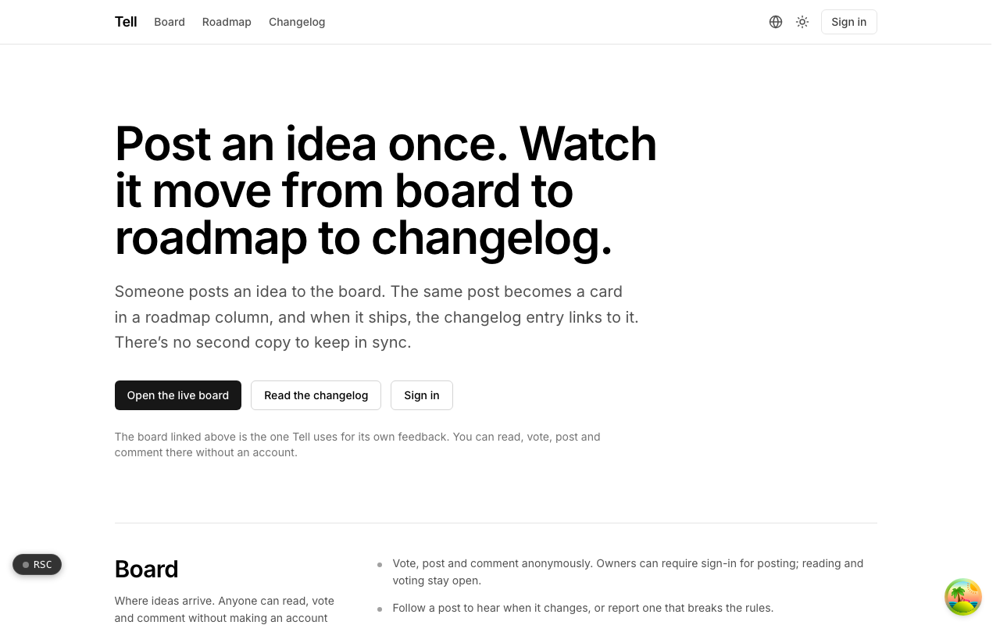
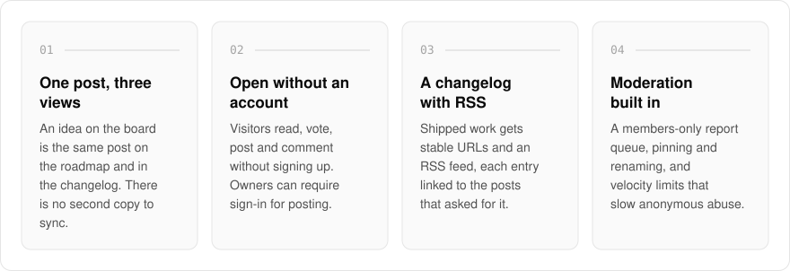
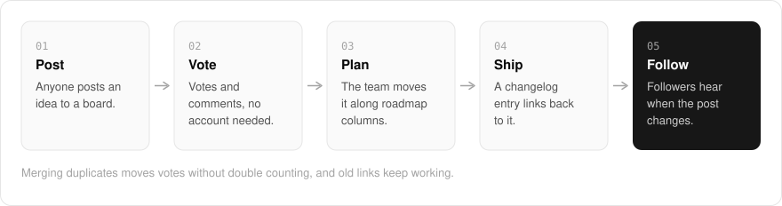
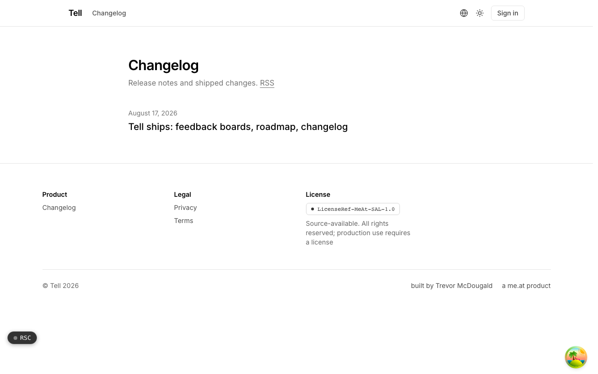

  <picture>
    <source media="(prefers-color-scheme: dark)" srcset=".github/assets/hero-dark.png">
    
  </picture>

<h1 align="center">tell.me.at</h1>

<strong>Post an idea once. Watch it move from board to roadmap to changelog.</strong>

  
  
  

  <a href="#features">Features</a> ·
  <a href="#how-it-works">How it works</a> ·
  <a href="#screenshots">Screenshots</a> ·
  <a href="#built-with">Built with</a>

Feedback usually lives in three tools: a board for requests, a roadmap someone updates by hand, and a changelog that never links back to who asked. I built tell.me.at to be all three in one place. Someone posts an idea to the board, the same post becomes a card in a roadmap column, and when it ships the changelog entry links back to it, so there is no second copy to keep in sync. Visitors read, vote and post without an account, the team keeps the moderation controls, and Tell runs its own feedback on a Tell board.

  <picture>
    <source media="(prefers-color-scheme: dark)" srcset=".github/assets/overview-dark.svg">
    
  </picture>

## Why tell.me.at

| The usual feedback stack | tell.me.at |
| --- | --- |
| A board, a roadmap and a changelog in separate tools | One post that moves from board to roadmap to changelog |
| Copies to keep in sync by hand | The changelog entry links back to the posts that asked for it |
| Voting needs an account | Read, vote, post and comment without one |
| Duplicates split the votes | Merging moves votes without double counting, and old links keep working |

## Features

- **Public boards**: read, vote, post and comment without making an account. Owners can require sign-in for posting while reading and voting stay open.
- **Roadmap view**: the same posts grouped into status columns, which team members can move along.
- **Changelog with RSS**: shipped work is published with stable URLs and an RSS feed, each entry linked to the posts that asked for it.
- **Follow and merge**: follow a post to hear when it changes. Merging duplicates moves votes without double counting, and old links keep working.
- **Moderation queue**: a members-only queue for reports, plus pinning, renaming and velocity limits on anonymous abuse.
- **Embeddable widget**: separately licensed, and it renders server-sanitized HTML, never raw user input.
- **Integrations and webhooks**: board events can be forwarded to Slack, Linear and Jira, or delivered as webhooks through hook.me.at.

## How it works

  <picture>
    <source media="(prefers-color-scheme: dark)" srcset=".github/assets/flow-dark.svg">
    
  </picture>

A post is the one record behind all three views. Votes and comments collect on it on the board, the team moves it through status columns on the roadmap, and publishing a changelog entry links that entry back to the post. People following the post hear about each change, and the changelog is also published as an RSS feed.

## Screenshots

<table>
  <tr>
    <td width="50%"><picture><source media="(prefers-color-scheme: dark)" srcset=".github/assets/hero-dark.png"></picture> The landing page: how one post moves from board to roadmap to changelog, with a link to the live board.</td>
    <td width="50%"><picture><source media="(prefers-color-scheme: dark)" srcset=".github/assets/changelog-dark.png"></picture> The changelog: release notes and shipped changes, with an RSS feed.</td>
  </tr>
</table>

## Built with

  
  
  
  
  
  

- Next.js 16 (App Router), React 19, TypeScript
- Tailwind CSS 4
- Drizzle ORM + Postgres
- Better Auth, with optional organisation SSO over OIDC
- Pro plan checkout through pay.me.at

## Part of the me.at family

tell.me.at is one of my [`*.me.at`](https://me.at) apps. They share one design system, account, and app shell. Development happens in a private monorepo; this repository is the project's public-facing home.

## License

Source-available. See [LICENSE](LICENSE).
